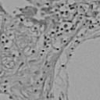
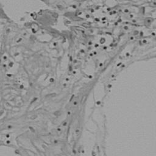
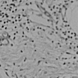
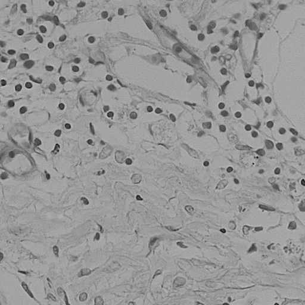

# RP-MIN

Code for **Single Image Super Resolution with Displacement-Derived Differential Features under Bright-field Microscopy**.

The manuscript has been submitted to [*Biomedical Signal Processing and Control*](https://www.sciencedirect.com/journal/biomedical-signal-processing-and-control) and is currently under consideration.

## Overview

RP-MIN reconstructs a higher-resolution bright-field microscopy image from a single low-resolution input. It computes eight directional difference images by shifting the input by subpixel amounts and subtracting the original. The Adaptive Multivariate Fusion Module (AMFM) uses cross-view correlations and differences to fuse those features. A deformable encoder–decoder integrates spatial information at multiple scales, and the Refined Perception Upsampling Module (RPUM) uses learned sampling offsets to reconstruct fine details.


*Figure 2. Updated RP-MIN architecture. LightGlue is used in offline pair preparation. Inference takes a single LR image.*

## MFA-Cell manuscript results

Table 2 of the submitted manuscript reports the following RP-MIN PSNR (dB) / SSIM values.

| Scale | PSNR / SSIM |
| :---: | ---: |
| ×2 | 31.24 / 0.86 |
| ×4 | 27.68 / 0.67 |

## Qualitative examples

Each row shows the same field of view. All images use the same display scale so their relative sizes reflect their pixel dimensions.

| Scale | LR input region | RP-MIN reconstruction (SR) | Ground-truth HR (registered) |
| :---: | :---: | :---: | :---: |
| ×2 | <br><sub>128 × 128 px</sub> | <br><sub>256 × 256 px</sub> | <br><sub>256 × 256 px</sub> |
| ×4 | <br><sub>128 × 128 px</sub> | <br><sub>512 × 512 px</sub> | <br><sub>512 × 512 px</sub> |

## Reproduce the MFA-Cell holdout test

Place the archived `rpmin-mfa-cell-x2-w32.pth` and `rpmin-mfa-cell-x4-w32.pth` files in `weights/mfa_cell/`. The test checks the checkpoint hashes and aligned reference pixels against [mfa_cell_test.json](scripts/mfa_cell_test.json).

With prepared references laid out as `x2/test/aligned.csv` and `x4/test/aligned.csv` beneath `runs/mfa_cell/references/`, run:

```bash
python scripts/test_mfa_cell.py --device cuda:0
```

To regenerate the aligned references, pass the root of the original dataset:

```bash
python scripts/test_mfa_cell.py --dataset /path/to/SuperResolutionDataset --device cuda:0
```

The verified environment used Python 3.12, PyTorch 2.8.0 and torchvision 0.23.0 with CUDA 12.8. Reference regeneration uses OpenCV 4.13.0 and the recorded registration transforms.

The two scales share four held-out fields and 308 RGB scoring windows per seed. The ×2 checkpoint uses patch-wise D4 self-ensemble. The ×4 checkpoint uses whole-field D4 self-ensemble, followed by window scoring. Both use seeds 101–105. The test writes one LR/SR/HR crop triplet per field at seed 101 and four full-field ×4 predictions under `runs/mfa_cell/predictions/`. The PNGs are for visual inspection. The evaluator computes PSNR and SSIM from floating-point predictions. Use `--metrics-out runs/mfa_cell/metrics` to save the computed metrics locally.

## Run the code

Use Python 3.12 and a PyTorch build for your device. From the repository root, install the dependencies for training, inference, and optional LightGlue registration.

```bash
python -m pip install -r requirements-registration.txt
python -m unittest discover -s tests
```

Training and evaluation take a paired CSV manifest with `id`, `split`, `group`, `lr`, and `hr` columns. Assign every source group to a single split and use spatially aligned pairs at the requested scale. For collection folders with `x10/`, `x20/`, and `x40/` images, `prepare-dataset` can index pairs and create grouped splits. `align-references` prepares spatially aligned reference pairs.

```bash
python -m rpmin prepare-dataset --root /path/to/SuperResolutionDataset --out runs/pairs
python -m rpmin --device cuda train --manifest /path/to/aligned.csv --scale 4 --out runs/model
python -m rpmin --device cuda evaluate --manifest /path/to/aligned.csv --split test \
  --checkpoint runs/model/best.pt --out runs/evaluation
```

To super-resolve one image with a checkpoint you have trained, pass the LR image and checkpoint to `infer`. The checkpoint determines the output scale.

```bash
python -m rpmin --device cuda infer \
  --input /path/to/lr.png \
  --checkpoint runs/model/best.pt \
  --out runs/example-x4.png
```

## License

RP-MIN is released under the [MIT License](LICENSE).

See the [third-party license notices](THIRD_PARTY_LICENSES).
