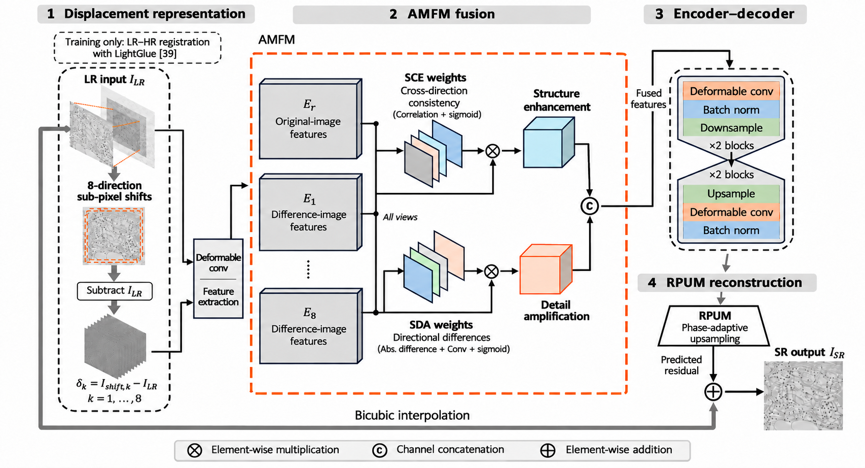
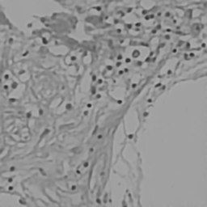
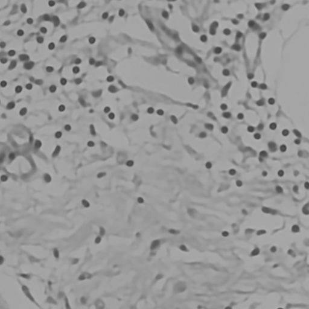

# RP-MIN

Code for **Single Image Super Resolution with Displacement-Derived Differential Features under Bright-field Microscopy**.

The manuscript has been submitted to [*Biomedical Signal Processing and Control*](https://www.sciencedirect.com/journal/biomedical-signal-processing-and-control) and is currently under consideration.

## Overview

RP-MIN reconstructs a higher-resolution bright-field microscopy image from a single low-resolution input. It computes eight directional difference images by shifting the input by subpixel amounts and subtracting the original. The Adaptive Multivariate Fusion Module (AMFM) uses cross-view correlations and differences to fuse those features. A deformable encoder–decoder integrates spatial information at multiple scales, and the Refined Perception Upsampling Module (RPUM) uses learned sampling offsets to reconstruct fine details.



*Figure 2. Updated RP-MIN architecture. LightGlue is used in offline pair preparation. Inference takes a single LR image.*

## Quantitative results

**Table 2.** Performance on Mitos-Atypia-14 and MFA-Cell, as reported in the submitted manuscript. Each entry gives PSNR (dB) / SSIM. Higher is better for both metrics.

| Method | Architecture | Mitos-Atypia-14, ×2 (10× → 20×) | MFA-Cell, ×2 (10× → 20×) | Mitos-Atypia-14, ×4 (10× → 40×) | MFA-Cell, ×4 (10× → 40×) |
| --- | --- | ---: | ---: | ---: | ---: |
| PathSRGAN | GAN | 21.23 / 0.70 | 24.67 / 0.63 | 18.80 / 0.50 | 23.57 / 0.51 |
| SwinIR | Transformer | 26.57 / 0.84 | 25.36 / 0.63 | 24.96 / 0.71 | 25.13 / 0.59 |
| RepRFN | CNN | 26.84 / 0.84 | 25.90 / 0.64 | 25.09 / 0.72 | 25.42 / 0.60 |
| Bicubic | Computation | 19.33 / 0.45 | 23.30 / 0.61 | 17.79 / 0.33 | 23.21 / 0.51 |
| SeemoRe | CNN | 26.16 / 0.87 | 28.30 / 0.85 | 26.03 / 0.76 | 27.07 / 0.66 |
| SR3 | Diffusion | 21.63 / 0.52 | 22.97 / 0.59 | 20.16 / 0.45 | 20.81 / 0.34 |
| **RP-MIN (ours)** | CNN | **28.58 / 0.89** | **31.24 / 0.86** | **27.73 / 0.80** | **27.68 / 0.67** |

## Qualitative examples

| MFA-Cell ×2 reconstruction | MFA-Cell ×4 reconstruction |
| :---: | :---: |
|  |  |

## Run the code

Use Python 3.12 and a PyTorch build for your device. From the repository root, install the dependencies for training, inference, and optional LightGlue registration.

```bash
python -m pip install -r requirements-registration.txt
python -m unittest discover -s tests
```

The end-to-end training script expects a paired dataset directory with collection folders containing `x10/`, `x20/`, and `x40/` images. It builds grouped splits, prepares aligned pairs, trains both scales, selects configurations on validation data, and scores the held-out test fields.

```bash
bash scripts/train_from_scratch.sh /path/to/SuperResolutionDataset runs/full
```

To super-resolve one image with a checkpoint you have trained, pass the LR image and checkpoint to `infer`. The checkpoint determines the output scale.

```bash
python -m rpmin --device cuda infer \
  --input /path/to/lr.png \
  --checkpoint runs/full/models/x4/base/best.pt \
  --out runs/example-x4.png --self-ensemble
```

## Acknowledgments

The implementation was developed from [FBANet](https://github.com/yjsunnn/FBANet). Its license notice is preserved in [LICENSE-FBANet](LICENSE-FBANet).
